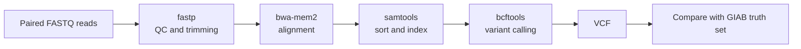

<div align="center">

# Variant Calling Workflow

**A reproducible short-read variant-calling pipeline, benchmarked against the GIAB HG002 truth set.**


</div>

This project aims to turn paired-end sequencing reads into a VCF of genetic
variants using a reproducible workflow. Calls will be compared with a trusted
Genome in a Bottle (GIAB) benchmark to measure precision and recall.

> **Current state:** the environment and reference/truth download scripts are
> ready. The calling workflow, read data, container, and benchmark results are
> still in development.

## At a glance

| Benchmark | Selection |
| --- | --- |
| **Sample** | HG002 / NA24385 |
| **Reference** | GRCh38, chromosome 20 |
| **Truth set** | GIAB v4.2.1 |
| **Benchmark region** | `chr20:10,000,000-12,000,000` |
| **Workflow tools** | Snakemake, fastp, bwa-mem2, samtools, bcftools |

## Planned workflow



Performance will be reported separately for single-nucleotide variants (SNVs)
and small insertions and deletions (indels).

## Progress

| Milestone | Status |
| --- | :---: |
| Pinned Conda environment | ✅ |
| Download and index GRCh38 chr20 | ✅ |
| Download and subset GIAB truth data | ✅ |
| Obtain HG002 reads for the target region | ⬜ |
| Implement the Snakemake calling workflow | ⬜ |
| Add a container build | ⬜ |
| Run the benchmark and report results | ⬜ |

## Quick start

### 1. Create the environment

```bash
conda env create -f environment.yml
conda activate varcall
```

### 2. Download the reference and truth data

```bash
bash scripts/download_reference.sh
bash scripts/download_truth.sh
```

The scripts save generated files under `data/`, which is excluded from Git.
Reference indexing uses `samtools` and `bwa-mem2`; truth-set processing uses
`bcftools` and `tabix`. These tools are included in the Conda environment.

## Tool versions

Versions are pinned in [`environment.yml`](environment.yml) for repeatable setup.

| Tool | Version | Use |
| --- | ---: | --- |
| Snakemake | 9.27.1 | Workflow management |
| fastp | 1.4.0 | Read quality control and trimming |
| bwa-mem2 | 2.3 | Read alignment |
| samtools | 1.24 | Alignment processing |
| bcftools | 1.24 | Variant calling and VCF processing |
| htslib | 1.24 | Genomic data utilities |

## Repository structure

```text
.
├── scripts/
│   ├── download_reference.sh
│   └── download_truth.sh
├── environment.yml
├── Snakefile
├── config.yaml
└── VALIDATION.md
```

## Validation

The benchmark procedure and metrics will be documented in
[`VALIDATION.md`](VALIDATION.md) once the end-to-end workflow is complete.
There are no pipeline accuracy results yet.
